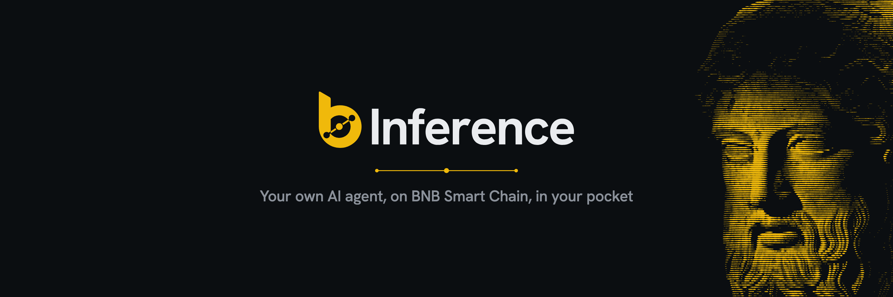
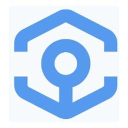

<p align="center">
  
</p>

<p align="center"><b>English</b> · <a href="README.zh.md">简体中文</a></p>

# bInference

bInference is an open-source AI agent for BNB Smart Chain. Deploy it as a trader, researcher, developer or anything you shape it into. It runs on your own machine, and you control it from Telegram and your other channels.

Hermes Agent, Meta's Muse and OpenClaw are AI agents for everyday life. bInference does what they do and is built for blockchain: it knows BNB Smart Chain inside out, so it trades, researches and acts there with a depth a general agent can't match.

**Your wallets, your rules, your tap.** The agent trades from its own wallets, inside limits you set. By default nothing moves until you tap; in auto mode it trades within your caps and tells you after.

[Website](https://binference.io) · [X](https://x.com/getbinference)

> [!IMPORTANT]
> bInference is in development and not ready for real funds.

## What it does

### Trade BSC launchpads &nbsp;&nbsp;

Launch your own token, catch new launches, trade the bonding curve and follow each token to its pool.

### Swap and automate &nbsp;

The best price across KyberSwap and OKX. Limit, take-profit, stop-loss, trailing stop, DCA and copy trading, run by code once you approve them; in this beta they fill on paper.

### Earn and bridge &nbsp;&nbsp;&nbsp;

Stake BNB with a validator or for slisBNB on Lista, and bridge to other chains with Across and Relay.

### Research &nbsp;

Reads X and any web page to explain a token, a narrative or a wallet before you decide. Cards show when an idea came from what it read.

### Market intelligence &nbsp;

Prices, charts, liquidity and trending tokens from DEX Screener and GeckoTerminal, and new launches read on chain.

### Full chain access &nbsp;&nbsp;&nbsp;&nbsp;&nbsp;

Reads any contract, wallet or transaction on BSC through public BNB Chain RPCs, or your own Alchemy, QuickNode, NodeReal, Ankr or Chainstack key, with automatic failover.

### Custody agentic wallet 

The wallet key lives in Privy's secure enclave, never on your machine. The agent signs only inside a policy that you alone can change, and a lost machine loses nothing.

### Private execution &nbsp;&nbsp;

Every transaction is simulated first, then sent privately through 48 Club, BlockRazor or PancakeSwap MEV Guard, out of reach of front-running bots.

### Token safety &nbsp;

Before any buy of an unknown token, GoPlus, honeypot.is and its own buy-and-sell simulation catch honeypots, hidden taxes and owner tricks.

### Alerts and automation 

Price and wallet alerts, scheduled check-ins ("review my portfolio every morning"), and TradingView alerts that fire your pre-approved orders, on paper in this beta.

### Portfolio

Positions, profit and loss at average cost, and a daily summary.

### Names and identity 

Send to `.bnb` names, and register each agent on chain with ERC-8004.

### Learns how you trade

Remembers your strategy and notes, and adds the agent skills you install.

## Your machine, your control &nbsp;&nbsp;&nbsp;

Run bInference on your own Mac with your own keys. The wallets are Privy wallets you own: no machine ever holds their keys, and a policy only you can change limits what any machine may sign. You talk to it on Telegram, in the web console (also inside Telegram as a Mini App), in the terminal, or from Claude Code, Codex and any MCP client.

Your agent has its own wallets and limits, and speaks English or Chinese. The bInference Router runs the AI by default; any compatible model provider works, local models included.

## Safe by design 

- In manual mode, the default, every transaction arrives as a card with exact amounts, fees and a simulated result. One tap sends it; no answer means no.
- Auto mode trades within your caps and sends a receipt after each trade. Sends, bridges, token launches, buys of unverified or warned tokens and anything over a cap still ask.
- Limits hold even after a tap: per-trade and 24-hour caps, slippage and tax limits, and send levels that decide where funds may go.
- Sends go only to your rescue address or addresses you saved. Even with its keys stolen, a machine can only call the trading contracts you enabled, and can lose at most a 24-hour cap through them.
- Every new agent starts in paper mode, with virtual money and real quotes.
- `/freeze` in Telegram, or Freeze in the console, stops everything. `/rescue`, or the console's rescue card, moves your funds to your own wallet, but the BNB kept for network fees.

## Install 

bInference supports macOS for now; Linux and Windows come in later releases. In Terminal:

```bash
curl -fsSL https://binference.io/install.sh | sh -s -- --beta
```

The script installs Node 26 when your Mac needs it, then bInference, then runs `binference init`, which sets it up. [Get started](apps/docs/src/content/docs/guides/getting-started.md) walks you from the setup to your first trade.

What each release changed for owners is in the [changelog](CHANGELOG.md).

The self-hosted agent charges no fees.

## Contributing

Read [CONTRIBUTING.md](CONTRIBUTING.md) and [AGENTS.md](AGENTS.md): every change, by a person or a coding agent, follows them.

## Security

Report security problems privately through [GitHub security advisories](../../security/advisories/new), never in a public issue.

## License

[MIT](LICENSE)
