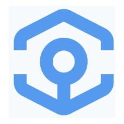

<p align="center">
  
</p>

<p align="center"><a href="README.md">English</a> · <b>简体中文</b></p>

# bInference

bInference 是一个面向 BNB Smart Chain 的开源 AI Agent。你可以把它部署成交易员、研究员、开发者，或任何你需要的角色。它运行在你自己的机器上，你在 Telegram 和其他渠道上指挥它。

Hermes Agent、Meta 的 Muse 和 OpenClaw 是面向日常生活的 AI Agent。bInference 能做到它们能做的事，并且专为区块链打造：它深入了解 BNB Smart Chain，在链上交易、调研和执行时，比通用 Agent 更专业。

**你的钱包，你的规则，你来确认。** Agent 用它自己的钱包、在你设定的限额内交易。默认情况下，没有你的确认什么都不会发生；开启自动模式后，它会在你的限额内自动交易，并在事后告诉你。

[官网](https://binference.io) · [X](https://x.com/getbinference)

> [!IMPORTANT]
> bInference 正在开发中，尚不能用于真实资金。

## 它能做什么

### 交易 BSC 发射台 &nbsp;&nbsp;

发射你自己的代币，抢先买入新发射的代币，在联合曲线上交易，并跟随每个代币进入流动性池。

### 兑换与自动化 &nbsp;

在 KyberSwap 和 OKX 之间寻找最优价格。限价单、止盈、止损、追踪止损、定投和跟单，批准后由代码执行；本测试版中它们只在模拟模式下成交。

### 收益与跨链 &nbsp;&nbsp;&nbsp;

向验证者质押 BNB，或在 Lista 上质押获得 slisBNB，并通过 Across 和 Relay 跨链到其他网络。

### 调研 &nbsp;

阅读 X 和任何网页，在你做决定之前讲清楚一个代币、一个叙事或一个钱包。如果某个想法来自它读到的外部内容，卡片上会标明。

### 市场情报 &nbsp;

来自 DEX Screener 和 GeckoTerminal 的价格、图表、流动性和热门代币，以及在链上读取的新发射代币。

### 完整链上访问 &nbsp;&nbsp;&nbsp;&nbsp;&nbsp;

通过公共 BNB Chain RPC，或你自己的 Alchemy、QuickNode、NodeReal、Ankr、Chainstack 密钥，读取 BSC 上的任何合约、钱包或交易，并自动切换备用节点。

### Agent 托管钱包 

钱包私钥保存在 Privy 的安全隔区中，从不落到你的机器上。Agent 只能在仅由你修改的策略范围内签名，即使机器丢失，资产也不会丢失。

### 私密执行 &nbsp;&nbsp;

每笔交易都先经过模拟，再通过 48 Club、BlockRazor 或 PancakeSwap MEV Guard 私密发送，让抢跑机器人无从下手。

### 代币安全 &nbsp;

买入任何陌生代币之前，GoPlus、honeypot.is 和它自己的买入卖出模拟会揪出貔貅盘、隐藏交易税和所有者的花招。

### 提醒与自动化 

价格和钱包提醒、定时检查（“每天早上检查我的投资组合”），以及触发你预先批准的订单的 TradingView 提醒（本测试版中只在模拟模式下成交）。

### 投资组合

持仓、按平均成本计算的盈亏和每日总结。

### 域名与身份 

向 `.bnb` 域名转账，并通过 ERC-8004 为每个 Agent 进行链上登记。

### 学习你的交易方式

记住你的策略和笔记，并添加你安装的 Agent 技能。

## 你的机器，你来掌控 &nbsp;&nbsp;&nbsp;

你可以用自己的密钥在自己的 Mac 上运行 bInference。钱包是归你所有的 Privy 钱包：任何机器都不会持有钱包私钥，而且只有你能修改的策略限定了任何机器可以签署的内容。你可以在 Telegram、网页控制台（也可作为 Mini App 在 Telegram 中打开）、终端，或从 Claude Code、Codex 和任何 MCP 客户端与它沟通。

你的 Agent 有自己的钱包和限额，支持中文和英文。AI 默认由 bInference Router 提供；任何兼容的模型服务商也都可以使用，包括本地模型。

## 安全设计 

- 默认的手动模式下，每笔交易都以卡片形式出现，列明准确金额、费用和模拟结果。点一下即发送；不回复就等于拒绝。
- 自动模式在你的限额内交易，并在每笔交易后发送回执。转账、跨链、发币、买入未经验证或有风险提示的代币，以及任何超出限额的操作仍需你确认。
- 点了确认也照样有效的限额：单笔上限和 24 小时上限、滑点和交易税上限，以及决定资金可以转往何处的转账级别。
- 资金只能转往你的紧急转出地址或你保存过的地址。即使密钥被盗，这台机器也只能调用你启用的交易合约，通过它们造成的损失不会超过 24 小时上限。
- 每个新 Agent 都从模拟模式开始，使用虚拟资金和真实报价。
- Telegram 中的 `/freeze` 或控制台中的「冻结」立即停止一切。`/rescue` 或控制台中的紧急转出卡片把资金转回你自己的钱包，只留下支付网络手续费的 BNB。

## 安装 

bInference 目前只支持 macOS；Linux 和 Windows 将在之后的版本中支持。在“终端”中运行：

```bash
curl -fsSL https://binference.io/install.sh | sh -s -- --beta
```

脚本会在你的 Mac 需要时安装 Node 26，然后安装 bInference，再运行 `binference init` 完成设置。[开始使用](apps/docs/src/content/docs/zh-cn/guides/getting-started.md)带你从设置走到第一笔交易。

自托管的 Agent 不收取任何费用。

## 参与贡献

请阅读 [CONTRIBUTING.md](CONTRIBUTING.md) 和 [AGENTS.md](AGENTS.md)：无论是人还是编程 Agent，每一次修改都要遵守其中的规则。

## 安全

请通过 [GitHub 安全公告](../../security/advisories/new) 私下报告安全问题，切勿在公开 issue 中提交。

## 许可证

[MIT](LICENSE)
